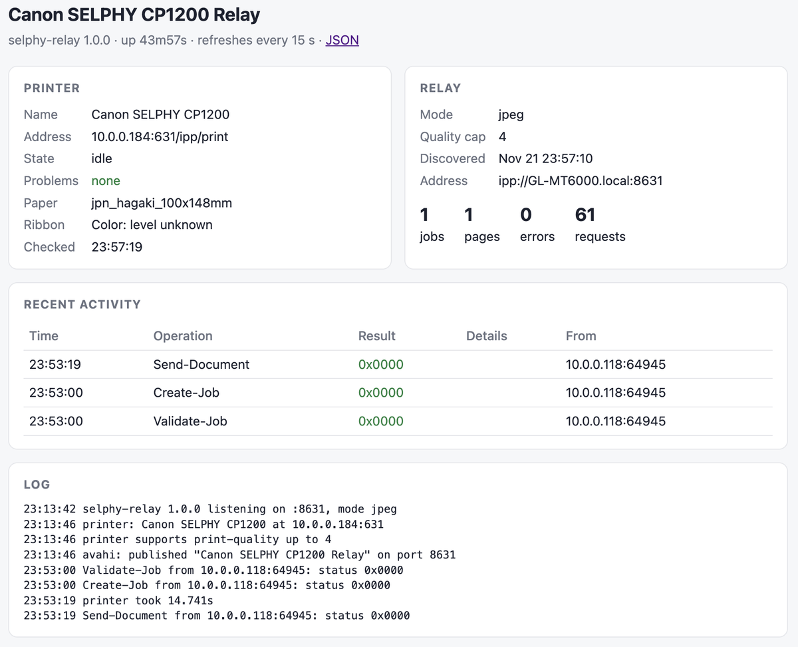

# selphy-relay

An AirPrint relay that lets current iPhones and iPads print to a **Canon SELPHY CP1200** again.
It runs on an OpenWrt / GL.iNet router (or any Linux box with avahi), appears on phones as
"*&lt;printer name&gt; Relay*", and forwards jobs to the printer while working around its firmware bugs.

> **Status: early.** Developed and tested on a GL.iNet Flint 2 (GL-MT6000) with a CP1200 and current Apple devices.
> Reports from other routers, iOS versions and SELPHY models are welcome — please open an issue.

## Why

The CP1200 (2016) is retired by Canon and gets no further firmware. Its built-in IPP server has bugs that current iOS
versions run into:

| # | Bug | Symptom | What the relay does |
|---|-----|---------|---------------------|
| 1 | Get-Printer-Attributes replies are cut off at ~8 KB. iOS requests `media-col-database`, which pushes the reply over the limit; the printer then closes an unfinished collection with an end tag, producing invalid IPP. | Phone finds the printer, then "can't connect". | Removes `media-col-database` from the request and rebuilds it from `media-col-ready` (the loaded paper size, bordered and borderless). |
| 2 | Overlapping requests corrupt replies. iOS polls status on a second connection while sending the job; the job's reply comes back as garbage. | "Error printing the document", job cancelled, printer stuck on BUSY. | Sends the printer one request at a time. |
| 3 | A job sent as Apple raster (URF) was accepted and reported as printed, but nothing came out; the same image as JPEG prints immediately. Possibly a side effect of #2. | Printer shows BUSY, then nothing. | Converts URF to JPEG (sRGB pixel values copied as-is, JPEG quality 95). `mode off` lets you test without conversion. |

It also caps `print-quality` at what the printer supports (iOS sends "high" for photos; the CP1200 only supports
"normal"), and prints multi-page jobs (several photos at once) as one printer job per page, retrying while the
printer is busy.

Tried and rejected: telling iOS the printer accepts JPEG only (iOS then won't print to it); patching the quality byte
inside the URF data (made the printer's replies worse).

## Install (OpenWrt / GL.iNet)

Needs `avahi-daemon`, which GL.iNet firmware already runs. On the router:

```sh
cd /tmp
wget https://github.com/im-evo/selphy-relay/releases/latest/download/selphy-relay.tar.gz
tar xzf selphy-relay.tar.gz && cd selphy-relay && ./install.sh
```

(If the router's `wget` can't do HTTPS, download the tarball on a computer and `scp -O` it to `/tmp`.)

Then print to "*&lt;printer name&gt; Relay*". Status page: `http://<router>:8631/`.
Upgrade: run the same commands again (your config is kept). Uninstall: `./install.sh uninstall`.

The installer adds the binary, init script and config to `/etc/sysupgrade.conf`. After a firmware upgrade, run
`/etc/init.d/selphy-relay enable && /etc/init.d/selphy-relay start` once (the boot link isn't preserved).

## Configuration

Edit `/etc/config/selphy-relay`, then `/etc/init.d/selphy-relay restart`:

| Option | Default | Meaning |
|---|---|---|
| `enabled` | `1` | |
| `listen` | `:8631` | Relay and status page address |
| `match` | `SELPHY` | Use the first printer whose mDNS name or model contains this text |
| `printer` | *(empty)* | Fixed `host:port` instead of discovery |
| `iface` | `br-lan` | LAN interface used for discovery |
| `mode` | `jpeg` | `jpeg` convert URF to JPEG · `patch` only cap quality · `off` pass documents through |
| `jpeg_quality` | `95` | |
| `quality` | `0` | Max print-quality; `0` = the printer's own maximum |
| `name` | *(empty)* | Name shown on phones (default "&lt;printer name&gt; Relay") |

The relay finds the printer via mDNS and re-checks its address every 2 minutes, so no DHCP reservation is needed.
It generates its avahi service from the printer's own advertisement, with its own UUID and a `relay=` marker so it
never discovers itself.

## Status page

`http://<router>:8631/` shows printer state and problems as the printer reports them (paper, ribbon, errors), the
loaded paper size, recent jobs with results, counters and the log. A switched-off printer shows as "offline"
(not an error); only print jobs that fail count as failed. `/status.json` has the same data.



## Limits

* Phones only see paper sizes for the loaded cassette (the printer can only print that size anyway). Borderless and
  bordered are both offered.
* No IPPS (TLS) between phone and relay — it is meant for your own LAN.
* Finish (glossy / textured) and other SELPHY extras are not exposed by the printer over AirPrint at all.
* Other SELPHY models may share these bugs; untested.

## Build

Go standard library only.

```sh
./scripts/build-release.sh        # all targets + tarball in dist/
CGO_ENABLED=0 GOOS=linux GOARCH=arm64 go build -trimpath -ldflags="-s -w" -o selphy-relay .
```

## License

MIT — see [LICENSE](LICENSE).
